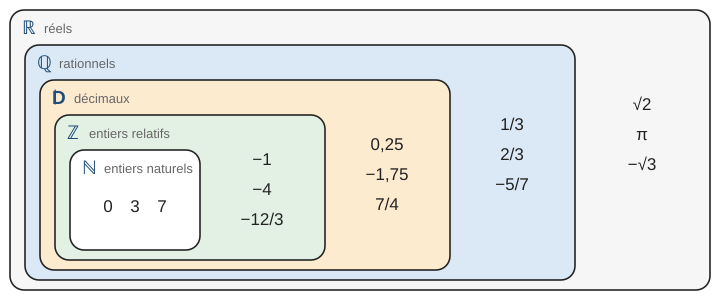
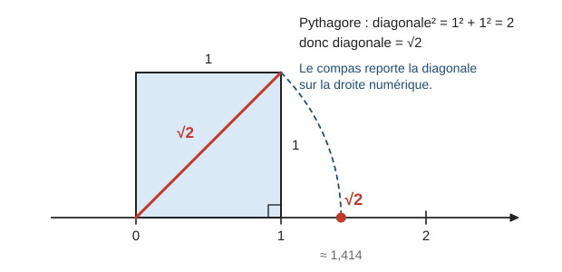
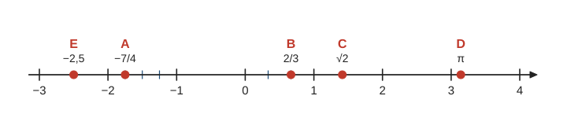
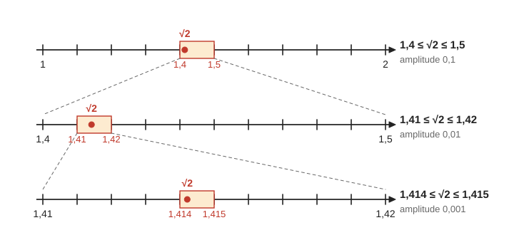
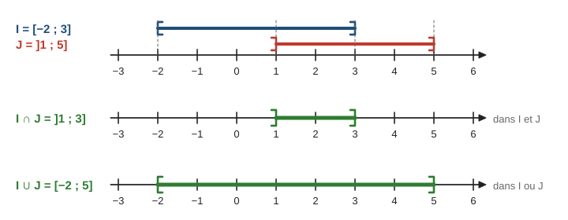
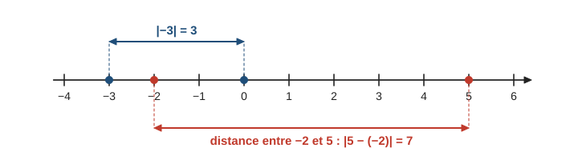
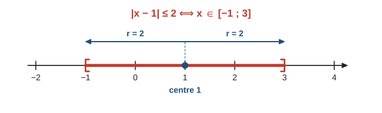

# Nombres réels et intervalles

> Compendium seconde — chapitre 1, partie « Nombres et calculs, algèbre » (programme de seconde générale et technologique, BO n° 14 du 2 avril 2026).  
> Cours compact pour un élève de niveau moyen : intuition, méthode, exemples guidés, erreurs fréquentes, puis exercices progressifs (★ facile, ★★ standard, ★★★ approfondissement) avec corrigés détaillés.

---

## 0. Ce qu’on vise

**En une phrase :** au collège, on a rencontré beaucoup de sortes de nombres ; en seconde, on les **range en ensembles**, on les place **tous sur une même droite**, et on décrit des morceaux de cette droite avec les **intervalles** et la **valeur absolue**.

À la fin de ce chapitre, je sais :

1. Dire si un nombre est entier naturel, entier relatif, décimal, rationnel ou seulement réel, et utiliser $\mathbb{N}$, $\mathbb{Z}$, $\mathbb{D}$, $\mathbb{Q}$, $\mathbb{R}$ avec le symbole $\in$.
2. Expliquer pourquoi $\dfrac{1}{3}$ n’est pas décimal et pourquoi $\sqrt{2}$ n’est pas rationnel (deux démonstrations du programme).
3. Placer un réel sur la droite numérique, l’**encadrer** par des décimaux et l’**arrondir** avec un nombre de chiffres adapté.
4. Écrire, représenter et lire un **intervalle** ; trouver l’intersection et la réunion de deux intervalles.
5. Utiliser la **valeur absolue** comme une distance et traduire $\lvert x - a \rvert \leqslant r$ par un intervalle.

> **Prérequis.** Collège : fractions (simplifier, passer à l’écriture décimale), nombres relatifs sur une droite graduée, racine carrée et théorème de Pythagore, inéquations simples comme $x \geqslant 3$. Pour la parité (pair, impair), voir aussi le chapitre 2, § 2.

---

## 1. Les ensembles de nombres

### 1.1 Cinq familles emboîtées

Chaque fois qu’on a eu besoin de nouveaux nombres, on a agrandi la famille. Pour **compter**, les entiers $0, 1, 2, \ldots$ suffisent. Pour une température sous zéro, il faut des **négatifs**. Pour un prix ou une mesure, des **décimaux**. Pour partager en trois, des **fractions**. Enfin, la diagonale d’un carré de côté $1$ mesure $\sqrt{2}$, qui n’est même pas une fraction (§ 3).

> **Définitions.**
> - $\mathbb{N}$ : les **entiers naturels** $0, 1, 2, 3, \ldots$
> - $\mathbb{Z}$ : les **entiers relatifs** $\ldots, -2, -1, 0, 1, 2, \ldots$
> - $\mathbb{D}$ : les **nombres décimaux**, qui s’écrivent $\dfrac{a}{10^n}$ avec $a$ entier relatif et $n$ entier naturel. Ce sont les nombres qui ont un nombre **fini** de chiffres après la virgule.
> - $\mathbb{Q}$ : les **nombres rationnels**, qui s’écrivent $\dfrac{a}{b}$ avec $a$ et $b$ entiers relatifs, $b \neq 0$.
> - $\mathbb{R}$ : les **nombres réels**, c’est-à-dire toutes les abscisses des points d’une droite graduée.

On écrit $3 \in \mathbb{N}$ (« $3$ **appartient** à $\mathbb{N}$ ») et $-3 \notin \mathbb{N}$ (« $-3$ n’appartient pas à $\mathbb{N}$ »).

Chaque famille contient la précédente : un entier naturel est un entier relatif, un entier est un décimal ($7 = \dfrac{7}{10^0}$), un décimal est une fraction ($0{,}25 = \dfrac{25}{100}$). On le note avec le symbole $\subset$ (« est inclus dans ») :

$$\mathbb{N} \subset \mathbb{Z} \subset \mathbb{D} \subset \mathbb{Q} \subset \mathbb{R}$$

Le schéma ci-dessous montre ces ensembles emboîtés. Chaque nombre est écrit dans le **plus petit** ensemble qui le contient ; il appartient aussi à tous les ensembles qui l’entourent.



Les réels qui ne sont pas rationnels s’appellent les **irrationnels** (par exemple $\sqrt{2}$ et $\pi$, voir § 3).

**Exemple guidé 1.** Pour chaque nombre, donner le plus petit ensemble parmi $\mathbb{N}$, $\mathbb{Z}$, $\mathbb{D}$, $\mathbb{Q}$, $\mathbb{R}$ qui le contient : a) $\sqrt{49}$ ; b) $-\dfrac{12}{3}$ ; c) $\dfrac{7}{4}$ ; d) $\dfrac{2}{3}$ ; e) $3{,}14$ ; f) $\sqrt{2}$.

**Réflexion.** On ne juge pas sur l’allure de l’écriture : on **simplifie d’abord**, puis on classe.

> a) $\sqrt{49} = 7$, donc $\sqrt{49} \in \mathbb{N}$.  
> b) $-\dfrac{12}{3} = -4$ : entier négatif, donc dans $\mathbb{Z}$ mais pas dans $\mathbb{N}$.  
> c) $\dfrac{7}{4} = 1{,}75 = \dfrac{175}{100}$ : décimal non entier, donc dans $\mathbb{D}$.  
> d) $\dfrac{2}{3} = 0{,}666\ldots$ : rationnel non décimal (§ 2), donc dans $\mathbb{Q}$.  
> e) $3{,}14 = \dfrac{314}{100}$ : décimal, donc dans $\mathbb{D}$. Ce n’est **pas** $\pi$.  
> f) $\sqrt{2}$ est irrationnel (§ 3) : il est seulement dans $\mathbb{R}$.

**Contrôle.** Chaque réponse est cohérente avec le schéma : $7$ est aussi dans $\mathbb{Z}$, $\mathbb{D}$, $\mathbb{Q}$ et $\mathbb{R}$.

> **Erreur fréquente.** Classer d’après l’écriture. « $\sqrt{49}$ n’est pas un entier, car il y a une racine » est faux : $\sqrt{49} = 7$. « $-\dfrac{12}{3}$ est une fraction, donc pas un entier » est faux : c’est $-4$. On simplifie toujours avant de classer.

> **Erreur fréquente.** Écrire $\pi = 3{,}14$. Le nombre $3{,}14$ n’est qu’une **valeur approchée** de $\pi$ : $\pi = 3{,}14159\ldots$ On écrit $\pi \approx 3{,}14$.

### 1.2 Reconnaître un décimal

> **Méthode — Montrer qu’une fraction est décimale.**
> 1. Rendre la fraction irréductible.
> 2. Chercher un nombre qui multiplie le dénominateur pour donner $10$, $100$, $1\,000$…
> 3. Écrire la fraction de dénominateur $10^n$, puis l’écriture décimale.

> $\dfrac{3}{8} = \dfrac{3 \times 125}{8 \times 125} = \dfrac{375}{1\,000} = 0{,}375$ ; $\quad \dfrac{7}{20} = \dfrac{7 \times 5}{20 \times 5} = \dfrac{35}{100} = 0{,}35$.

*Pour aller plus loin (★★★).* Une fraction **irréductible** est décimale si et seulement si son dénominateur n’a pas d’autre facteur premier que $2$ et $5$. Ainsi $\dfrac{3}{8}$ ($8 = 2^3$) est décimal, mais $\dfrac{5}{6}$ ($6 = 2 \times 3$) ne l’est pas.

---

## 2. Des rationnels qui ne sont pas décimaux

### 2.1 Une division qui ne s’arrête pas

Posons la division de $1$ par $3$ : on obtient $0{,}3$ et il reste $1$, puis $0{,}33$ et il reste encore $1$… Le reste $1$ revient sans cesse, donc les chiffres $3$ se répètent **indéfiniment** : $\dfrac{1}{3} = 0{,}333\ldots$

> **Méthode — Montrer qu’une fraction n’est pas décimale (division).** On pose la division. Si un **reste non nul revient**, les mêmes chiffres se répètent pour toujours : l’écriture décimale ne s’arrête jamais, la fraction n’est pas décimale.

> **Erreur fréquente.** « La calculatrice affiche $0{,}3333333333$, donc $\dfrac{1}{3}$ est décimal. » La calculatrice ne garde qu’une dizaine de chiffres : elle **arrondit**. D’ailleurs $0{,}3333333333 \times 3 = 0{,}9999999999$, et non $1$.

### 2.2 Démonstration : $\dfrac{1}{3}$ n’est pas décimal

On utilise un **raisonnement par l’absurde** : on suppose le contraire de ce qu’on veut montrer, et on aboutit à une contradiction (chapitre 17, § 5).

> **Propriété.** Le nombre rationnel $\dfrac{1}{3}$ n’est pas décimal.
>
> *Démonstration.* Supposons que $\dfrac{1}{3}$ soit décimal. Il s’écrit alors $\dfrac{1}{3} = \dfrac{a}{10^n}$, avec $a$ entier et $n$ entier naturel.  
> En multipliant les deux membres par $3 \times 10^n$, on obtient $10^n = 3a$. Donc $10^n$ serait un multiple de $3$.  
> Or $10^n$ s’écrit avec un $1$ suivi de zéros : la somme de ses chiffres vaut $1$, qui n’est pas un multiple de $3$. Donc $10^n$ n’est pas un multiple de $3$.  
> C’est une contradiction : $\dfrac{1}{3}$ n’est pas décimal.

On a donc $\mathbb{D} \neq \mathbb{Q}$ : il y a des rationnels qui ne sont pas décimaux.

*Pour aller plus loin (★★★).* L’écriture décimale d’un rationnel finit toujours par se **répéter** : $\dfrac{1}{7} = 0{,}142857\,142857\ldots$ (période $142857$). Inversement, on peut retrouver la fraction. Si $x = 0{,}777\ldots$, alors $10x = 7{,}777\ldots$, donc $10x - x = 7$, soit $9x = 7$ et $x = \dfrac{7}{9}$.

---

## 3. Des réels qui ne sont pas rationnels

### 3.1 La diagonale du carré

Un carré de côté $1$ a une diagonale $d$ telle que $d^2 = 1^2 + 1^2 = 2$ (théorème de Pythagore). Donc $d = \sqrt{2}$. Avec un compas, on reporte cette diagonale sur la droite numérique : on obtient le point d’abscisse $\sqrt{2}$, comme sur le schéma ci-dessous.



Ce point existe bien sur la droite. Pourtant, son abscisse $\sqrt{2}$ ne s’écrit pas comme une fraction : c’est ce que les mathématiciens grecs ont découvert, à leur grande surprise.

### 3.2 Démonstration : $\sqrt{2}$ est irrationnel

On a besoin d’un résultat sur la parité (chapitre 2, § 2). Si $n$ est impair, il s’écrit $n = 2k + 1$ avec $k$ entier, et
$$n^2 = (2k + 1)^2 = 4k^2 + 4k + 1 = 2(2k^2 + 2k) + 1,$$
qui est impair. **Le carré d’un impair est impair.** Donc si $n^2$ est pair, $n$ ne peut pas être impair : $n$ est pair.

> **Propriété.** Le nombre réel $\sqrt{2}$ est irrationnel.
>
> *Démonstration (par l’absurde).* Supposons que $\sqrt{2} = \dfrac{p}{q}$, avec $p$ et $q$ entiers naturels non nuls et la fraction **irréductible**.  
> En élevant au carré : $2 = \dfrac{p^2}{q^2}$, donc $p^2 = 2q^2$. Ainsi $p^2$ est pair, donc $p$ est pair : $p = 2k$ avec $k$ entier.  
> Alors $(2k)^2 = 2q^2$, soit $4k^2 = 2q^2$, donc $q^2 = 2k^2$. Ainsi $q^2$ est pair, donc $q$ est pair.  
> $p$ et $q$ sont tous deux pairs : la fraction $\dfrac{p}{q}$ se simplifie par $2$. Cela contredit le fait qu’elle est irréductible.  
> Donc $\sqrt{2}$ n’est pas rationnel.

> **Propriété (admise).** Si l’entier naturel $n$ n’est pas le carré d’un entier, alors $\sqrt{n}$ est irrationnel ($\sqrt{3}$, $\sqrt{5}$, $\sqrt{10}$…). Le nombre $\pi$ est aussi irrationnel.

> **Erreur fréquente.** « Une racine carrée est toujours irrationnelle. » Faux : $\sqrt{9} = 3$ et $\sqrt{0{,}25} = 0{,}5$ sont décimaux. Seule la racine d’un entier qui **n’est pas un carré parfait** est irrationnelle.

> **Erreur fréquente.** « $\sqrt{2} = 1{,}414$. » Faux : $1{,}414^2 = 1{,}999\,396$, et non $2$. On écrit $\sqrt{2} \approx 1{,}414$. Aucun décimal, aucune fraction n’est exactement égal à $\sqrt{2}$.

---

## 4. La droite numérique, encadrements et arrondis

### 4.1 Placer un réel

> **Définition.** Sur une droite munie d’une origine (abscisse $0$) et d’une unité (abscisse $1$), **chaque réel est l’abscisse d’un point unique**, et chaque point a pour abscisse un réel. Cette droite s’appelle la **droite numérique**. Plus un point est à droite, plus son abscisse est grande.

**Exemple guidé 2.** Placer sur une droite numérique les points $E(-2{,}5)$, $A\left(-\dfrac{7}{4}\right)$, $B\left(\dfrac{2}{3}\right)$, $C(\sqrt{2})$ et $D(\pi)$, puis ranger ces abscisses dans l’ordre croissant.

**Réflexion.** Une fraction se place **exactement** en partageant l’unité : des quarts pour $-\dfrac{7}{4}$, des tiers pour $\dfrac{2}{3}$. Pour $\sqrt{2}$ et $\pi$, on utilise une valeur approchée (ou la construction du § 3.1 pour $\sqrt{2}$).

> $-\dfrac{7}{4} = -1{,}75$ : trois quarts d’unité à gauche de $-1$. $\dfrac{2}{3}$ : deux tiers de l’unité après $0$.  
> $\sqrt{2} \approx 1{,}41$ et $\pi \approx 3{,}14$.  
> Ordre croissant : $-2{,}5 < -\dfrac{7}{4} < \dfrac{2}{3} < \sqrt{2} < \pi$.



**Contrôle.** Sur le schéma ci-dessus, les points sont bien rangés de gauche à droite dans cet ordre. Pour deux négatifs, le plus petit est le plus éloigné de $0$ : $-2{,}5 < -1{,}75$.

### 4.2 Encadrer un réel par des décimaux

On ne peut pas écrire tous les chiffres de $\sqrt{2}$ ou de $\pi$. On **encadre** le nombre entre deux décimaux de plus en plus proches.

> **Définition.** Encadrer un réel $x$ **à $10^{-n}$ près**, c’est trouver deux décimaux $a$ et $b$, ayant $n$ chiffres après la virgule, tels que $a \leqslant x \leqslant b$ et $b - a = 10^{-n}$. Le nombre $b - a$ s’appelle l’**amplitude** de l’encadrement.

**Exemple guidé 3.** Encadrer $\sqrt{2}$ à $10^{-1}$ près, puis à $10^{-2}$ près, sans utiliser la touche $\sqrt{\ }$.

**Réflexion.** Les nombres sont positifs : si $a^2 \leqslant 2 \leqslant b^2$, alors $a \leqslant \sqrt{2} \leqslant b$. On teste donc des **carrés**.

> $1{,}4^2 = 1{,}96 < 2$ et $1{,}5^2 = 2{,}25 > 2$, donc $1{,}4 \leqslant \sqrt{2} \leqslant 1{,}5$ (amplitude $0{,}1$).  
> $1{,}41^2 = 1{,}988\,1 < 2$ et $1{,}42^2 = 2{,}016\,4 > 2$, donc $1{,}41 \leqslant \sqrt{2} \leqslant 1{,}42$ (amplitude $0{,}01$).



**Contrôle.** La calculatrice donne $\sqrt{2} \approx 1{,}414\,21$, qui est bien entre $1{,}41$ et $1{,}42$. Le schéma ci-dessus montre l’étape suivante : $1{,}414 \leqslant \sqrt{2} \leqslant 1{,}415$.

On peut confier ce **balayage** à un programme (chapitre 18) : on part de $1$ et on avance d’un pas tant que le carré du nombre suivant reste inférieur ou égal à $2$.

```python
def encadrement_racine2(n):
    pas = 10**(-n)
    a = 1
    while (a + pas)**2 <= 2:
        a = a + pas
    return round(a, n), round(a + pas, n)

print(encadrement_racine2(2))   # affiche (1.41, 1.42)
```

Sans `round`, Python afficherait `(1.4100000000000004, 1.4200000000000004)` : l’ordinateur calcule avec un nombre limité de chiffres binaires, donc ses résultats sont souvent **approchés**. De même, `0.1 + 0.2` affiche `0.30000000000000004`.

### 4.3 Arrondir, tronquer, chiffres significatifs

> **Définitions.**
> - La **troncature** de $x$ (positif) à $10^{-n}$ près : on garde $n$ chiffres après la virgule et on coupe le reste. C’est la borne inférieure de l’encadrement.
> - L’**arrondi** de $x$ à $10^{-n}$ près : la borne de l’encadrement la plus proche de $x$. En pratique, on regarde le chiffre suivant : de $0$ à $4$, on garde ; de $5$ à $9$, on augmente le dernier chiffre gardé de $1$.

> $\pi = 3{,}141\,59\ldots$ : troncature et arrondi au centième valent tous deux $3{,}14$.  
> $\dfrac{2}{3} = 0{,}666\ldots$ : troncature au centième $0{,}66$ ; arrondi au centième $0{,}67$.

Les **chiffres significatifs** d’un nombre sont tous ses chiffres à partir du premier chiffre non nul. Ainsi $0{,}007\,2$ a deux chiffres significatifs ($7$ et $2$) ; $12{,}0$ en a trois (le zéro final indique une mesure précise au dixième).

> **Méthode — Arrondir un résultat de problème.** Le résultat ne doit pas avoir plus de chiffres significatifs que la donnée **la moins précise**. On calcule avec toute la précision de la calculatrice, et on arrondit **seulement à la fin**.

**Exemple guidé 4.** Un cycliste parcourt $23{,}4\,\mathrm{km}$ en $1{,}27\,\mathrm{h}$. Quelle est sa vitesse moyenne ?

> $v = \dfrac{23{,}4}{1{,}27} \approx 18{,}425\,196\,85$ (affichage de la calculatrice).  
> Les deux données ont trois chiffres significatifs, donc on en garde trois : $v \approx 18{,}4\,\mathrm{km/h}$.

**Contrôle.** Ordre de grandeur : $24 \div 1{,}2 = 20$ ; le résultat $18{,}4$ est vraisemblable.

> **Erreur fréquente.** Recopier tous les chiffres de la calculatrice : « $v = 18{,}425\,196\,85\,\mathrm{km/h}$ ». Ces chiffres sont faux en pratique : les mesures ne sont précises qu’au dixième de kilomètre et au centième d’heure. Écrire $=$ au lieu de $\approx$ est une seconde erreur.

---

## 5. Les intervalles

### 5.1 Écrire et représenter un intervalle

Entre $-1$ et $3$, il y a une **infinité** de réels : $0$, $2{,}5$, $\sqrt{2}$, $\pi$, $-0{,}999$… On ne peut pas tous les écrire. On décrit l’ensemble entier par un **intervalle**.

> **Définition.** Pour deux réels $a < b$, les ensembles de réels décrits ci-dessous s’appellent des **intervalles**.

| Les réels $x$ tels que… | Intervalle | Se lit |
|---|---|---|
| $a \leqslant x \leqslant b$ | $\left[a\,;b\right]$ | intervalle fermé $a$, $b$ |
| $a < x < b$ | $\left]a\,;b\right[$ | intervalle ouvert $a$, $b$ |
| $a < x \leqslant b$ | $\left]a\,;b\right]$ | ouvert en $a$, fermé en $b$ |
| $a \leqslant x < b$ | $\left[a\,;b\right[$ | fermé en $a$, ouvert en $b$ |
| $x \geqslant a$ | $\left[a\,;+\infty\right[$ | $a$, plus l’infini |
| $x > a$ | $\left]a\,;+\infty\right[$ | |
| $x \leqslant b$ | $\left]-\infty\,;b\right]$ | moins l’infini, $b$ |
| $x < b$ | $\left]-\infty\,;b\right[$ | |

L’ensemble de tous les réels s’écrit $\mathbb{R} = \left]-\infty\,;+\infty\right[$.

Sur la droite, on surligne les réels concernés. Le **crochet tourné vers le trait** signifie que la borne est **comprise** ; tourné **vers l’extérieur**, elle est **exclue**. Le schéma ci-dessous montre quatre cas.


> **À retenir.** Du côté de $+\infty$ ou de $-\infty$, le crochet est **toujours ouvert** : l’infini n’est pas un nombre, on ne peut pas l’atteindre.

**Exemple guidé 5.** a) Écrire sous forme d’intervalle l’ensemble des réels $x$ tels que $-2 < x \leqslant 5$, puis tels que $x \geqslant -3$. b) Les nombres $5$, $-2$ et $\sqrt{30}$ appartiennent-ils à $\left]-2\,;5\right]$ ?

**Réflexion.** Inégalité stricte ($<$) : borne exclue, crochet ouvert. Inégalité large ($\leqslant$) : borne comprise, crochet fermé.

> a) $-2 < x \leqslant 5$ s’écrit $x \in \left]-2\,;5\right]$. $\quad x \geqslant -3$ s’écrit $x \in \left[-3\,;+\infty\right[$.  
> b) $5 \in \left]-2\,;5\right]$ (crochet fermé en $5$). $\;-2 \notin \left]-2\,;5\right]$ (crochet ouvert en $-2$).  
> $\sqrt{30}$ : $25 < 30 < 36$, donc $5 < \sqrt{30} < 6$. Ainsi $\sqrt{30} > 5$ et $\sqrt{30} \notin \left]-2\,;5\right]$.

**Contrôle.** $\sqrt{30} \approx 5{,}48$ à la calculatrice : c’est bien plus grand que $5$.

> **Méthode — Traduire une inégalité en intervalle.**
> 1. Repérer les bornes ; la plus petite s’écrit **à gauche**.
> 2. Pour chaque borne : inégalité large ($\leqslant$, $\geqslant$), crochet fermé ; inégalité stricte ($<$, $>$), crochet ouvert.
> 3. S’il n’y a pas de borne d’un côté, écrire $-\infty$ ou $+\infty$ avec un crochet ouvert.

> **Erreur fréquente.** Écrire $\left[3\,;-1\right]$ : la plus petite borne s’écrit toujours en premier, donc $\left[-1\,;3\right]$. Autre piège : $\left[2\,;+\infty\right]$ est faux, il faut $\left[2\,;+\infty\right[$.

### 5.2 Intersection et réunion

> **Définitions.** Soit $I$ et $J$ deux intervalles.
> - L’**intersection** $I \cap J$ (« $I$ inter $J$ ») est l’ensemble des réels qui sont **dans $I$ et dans $J$**.
> - La **réunion** $I \cup J$ (« $I$ union $J$ ») est l’ensemble des réels qui sont **dans $I$ ou dans $J$** (au moins l’un des deux).
> - Si aucun réel n’est dans les deux, l’intersection est l’**ensemble vide**, noté $\varnothing$.

**Exemple guidé 6.** Soit $I = \left[-2\,;3\right]$, $J = \left]1\,;5\right]$ et $K = \left[4\,;+\infty\right[$. Déterminer $I \cap J$, $I \cup J$, $I \cap K$ et $I \cup K$.

**Réflexion.** On dessine les intervalles sur **la même droite**, de deux couleurs, comme sur le schéma ci-dessous. L’intersection est la partie coloriée deux fois ; la réunion, tout ce qui est colorié.



> $I \cap J = \left]1\,;3\right]$ : $1$ est exclu ($1 \notin J$) ; $3$ est compris ($3 \in I$ et $3 \in J$).  
> $I \cup J = \left[-2\,;5\right]$.  
> $I \cap K = \varnothing$ : $I$ s’arrête en $3$ et $K$ commence en $4$.  
> $I \cup K = \left[-2\,;3\right] \cup \left[4\,;+\infty\right[$ : ce n’est pas un intervalle (il y a un « trou » entre $3$ et $4$), on le laisse sous cette forme.

**Contrôle.** On teste un nombre de chaque zone : $2$ est dans $I$ et dans $J$, donc dans $I \cap J$ ✓ ; $4{,}5$ est dans $J$ seulement, donc dans $I \cup J$ mais pas dans $I \cap J$ ✓.

> **Erreur fréquente.** Mal traiter une borne de l’intersection. En $1$ : $1 \in I$ mais $1 \notin J$, donc $1 \notin I \cap J$. Pour qu’une borne soit comprise dans l’intersection, il faut qu’elle soit dans **les deux** intervalles.

Les intervalles servent à écrire les **solutions d’une inéquation**. Par exemple, $2x - 3 > 5$ équivaut à $x > 4$ : l’ensemble des solutions est $S = \left]4\,;+\infty\right[$ (chapitre 5).

---

## 6. Valeur absolue et distance

### 6.1 La distance à zéro

Sur la droite, $-3$ et $3$ sont tous les deux à **3 unités** de $0$. Cette distance, toujours positive, s’appelle la valeur absolue.

> **Définition.** La **valeur absolue** d’un réel $a$, notée $\lvert a \rvert$, est la distance entre $0$ et $a$ sur la droite numérique :
> $$\lvert a \rvert = a \text{ si } a \geqslant 0, \qquad \lvert a \rvert = -a \text{ si } a \leqslant 0.$$
> Exemples : $\lvert 5 \rvert = 5$ ; $\lvert -3 \rvert = 3$ ; $\lvert 0 \rvert = 0$.

> **Propriété.** La **distance** entre deux réels $a$ et $b$ est $\lvert a - b \rvert$ (qui est égal à $\lvert b - a \rvert$).



Sur le schéma ci-dessus, la distance entre $-2$ et $5$ se compte en unités : $2$ unités jusqu’à $0$, puis $5$ : en tout $7$. Le calcul le confirme : $\lvert 5 - (-2) \rvert = \lvert 7 \rvert = 7$.

**Exemple guidé 7.** a) Calculer la distance entre $-4{,}5$ et $2$. b) Écrire sans valeur absolue $\lvert \sqrt{2} - 2 \rvert$ et $\lvert 1 - \pi \rvert$.

**Réflexion.** Pour enlever une valeur absolue, on cherche le **signe** de ce qu’elle contient : positif, on le garde ; négatif, on prend l’opposé.

> a) $\lvert 2 - (-4{,}5) \rvert = \lvert 6{,}5 \rvert = 6{,}5$.  
> b) $\sqrt{2} \approx 1{,}41 < 2$, donc $\sqrt{2} - 2 < 0$ et $\lvert \sqrt{2} - 2 \rvert = -(\sqrt{2} - 2) = 2 - \sqrt{2}$.  
> $\pi > 1$, donc $1 - \pi < 0$ et $\lvert 1 - \pi \rvert = \pi - 1$.

**Contrôle.** Une valeur absolue est toujours positive : $2 - \sqrt{2} \approx 0{,}59 > 0$ ✓ et $\pi - 1 \approx 2{,}14 > 0$ ✓.

> **Erreur fréquente.** Calculer une distance en ignorant les signes. Entre $-2$ et $5$, la distance n’est pas $5 - 2 = 3$ mais $\lvert 5 - (-2) \rvert = 7$. On écrit toujours la différence complète, avec ses parenthèses.

> **Erreur fréquente.** Croire que $-a$ est toujours négatif. Si $a = -3$, alors $-a = 3$ : c’est pourquoi $\lvert a \rvert = -a$ quand $a$ est négatif.

En seconde, la valeur absolue ne sert qu’à exprimer des **distances** et des intervalles (§ 6.2), ainsi que la fonction valeur absolue (chapitre 12).

### 6.2 Intervalle de centre $a$ et de rayon $r$

Les réels dont la distance à $1$ est au plus $2$ vont de $1 - 2 = -1$ à $1 + 2 = 3$, comme le montre le schéma ci-dessous.



> **Propriété.** Pour un réel $a$ et un réel $r > 0$ :
> $$\lvert x - a \rvert \leqslant r \iff x \in \left[a - r\,;a + r\right] \qquad \lvert x - a \rvert < r \iff x \in \left]a - r\,;a + r\right[$$
> $a$ est le **centre** de l’intervalle et $r$ son **rayon**. Inversement, l’intervalle $\left[b\,;c\right]$ a pour centre $\dfrac{b + c}{2}$ et pour rayon $\dfrac{c - b}{2}$.

> **Méthode — Traduire $\lvert x - a \rvert \leqslant r$.**
> 1. Écrire l’expression sous la forme $\lvert x - a \rvert$ : par exemple $\lvert x + 3 \rvert = \lvert x - (-3) \rvert$, le centre est $-3$.
> 2. Lire le centre $a$ et le rayon $r$.
> 3. Écrire $\left[a - r\,;a + r\right]$, crochets fermés pour $\leqslant$, ouverts pour $<$.

**Exemple guidé 8.** a) Écrire sous forme d’intervalle l’ensemble des réels $x$ tels que $\lvert x + 3 \rvert < 0{,}5$. b) Écrire l’intervalle $\left[2\,;8\right]$ à l’aide d’une valeur absolue.

> a) $\lvert x + 3 \rvert = \lvert x - (-3) \rvert$ : centre $-3$, rayon $0{,}5$. Donc $x \in \left]-3{,}5\,;-2{,}5\right[$.  
> b) Centre $\dfrac{2 + 8}{2} = 5$ ; rayon $\dfrac{8 - 2}{2} = 3$. Donc $x \in \left[2\,;8\right] \iff \lvert x - 5 \rvert \leqslant 3$.

**Contrôle.** a) $x = -3$ (le centre) convient : $\lvert 0 \rvert = 0 < 0{,}5$ ✓ ; $x = -2{,}5$ (une borne) donne $\lvert 0{,}5 \rvert = 0{,}5$, qui n’est pas $< 0{,}5$ : borne exclue ✓.

> **Erreur fréquente.** Prendre $3$ pour centre de $\lvert x + 3 \rvert \leqslant 2$. Le centre est $-3$, car $x + 3 = x - (-3)$ : l’intervalle est $\left[-5\,;-1\right]$, et non $\left[1\,;5\right]$.

**Exemple guidé 9 (tolérance de fabrication).** Une pièce doit mesurer $25\,\mathrm{mm}$ à $0{,}2\,\mathrm{mm}$ près. Traduire cette condition sur la longueur $L$ (en mm), puis dire si une pièce de $25{,}25\,\mathrm{mm}$ est acceptée.

> « $L$ vaut $25$ à $0{,}2$ près » signifie : la distance entre $L$ et $25$ est au plus $0{,}2$, soit $\lvert L - 25 \rvert \leqslant 0{,}2$.  
> Donc $L \in \left[24{,}8\,;25{,}2\right]$.  
> $25{,}25 > 25{,}2$ : la pièce est **refusée**.

**Contrôle.** $\lvert 25{,}25 - 25 \rvert = 0{,}25 > 0{,}2$ ✓.

*Pour aller plus loin (★★★).* L’inégalité contraire $\lvert x - a \rvert \geqslant r$ décrit les réels **loin** de $a$ : $x \in \left]-\infty\,;a - r\right] \cup \left[a + r\,;+\infty\right[$. Par exemple, $\lvert x - 1 \rvert \geqslant 2$ équivaut à $x \in \left]-\infty\,;-1\right] \cup \left[3\,;+\infty\right[$.

---

## 7. Mini-synthèse

> **À retenir.**
> - $\mathbb{N} \subset \mathbb{Z} \subset \mathbb{D} \subset \mathbb{Q} \subset \mathbb{R}$ ; on simplifie un nombre avant de le classer.
> - $\dfrac{1}{3}$ est rationnel mais pas décimal ; $\sqrt{2}$ est irrationnel (démonstrations par l’absurde).
> - Encadrer à $10^{-n}$ près : deux décimaux d’amplitude $10^{-n}$ ; arrondir à la fin, avec autant de chiffres significatifs que la donnée la moins précise.
> - $\left[a\,;b\right]$ : bornes comprises ; $\left]a\,;b\right[$ : bornes exclues ; toujours ouvert en $\pm\infty$.
> - $I \cap J$ : dans les deux ; $I \cup J$ : dans au moins l’un.
> - $\lvert a - b \rvert$ = distance entre $a$ et $b$ ; $\lvert x - a \rvert \leqslant r \iff x \in \left[a - r\,;a + r\right]$.

---

## 8. Exercices types

### A. Les ensembles de nombres (★)

**A1.** Recopier et compléter avec $\in$ ou $\notin$ : a) $-4 \;\ldots\; \mathbb{N}$ ; b) $-4 \;\ldots\; \mathbb{Z}$ ; c) $0{,}25 \;\ldots\; \mathbb{D}$ ; d) $\dfrac{1}{3} \;\ldots\; \mathbb{D}$ ; e) $\sqrt{2} \;\ldots\; \mathbb{Q}$ ; f) $\sqrt{16} \;\ldots\; \mathbb{N}$ ; g) $\pi \;\ldots\; \mathbb{R}$.

**A2.** Donner le plus petit ensemble ($\mathbb{N}$, $\mathbb{Z}$, $\mathbb{D}$, $\mathbb{Q}$ ou $\mathbb{R}$) qui contient chaque nombre : a) $\dfrac{18}{6}$ ; b) $-\dfrac{21}{7}$ ; c) $\dfrac{9}{4}$ ; d) $\dfrac{5}{6}$ ; e) $\sqrt{36}$ ; f) $\sqrt{5}$ ; g) $-0{,}07$ ; h) $10^{-3}$.

**A3.** Vrai ou faux ? a) Tout entier naturel est un entier relatif. b) Tout nombre décimal est un entier. c) $\mathbb{D} \subset \mathbb{Q}$. d) Il existe des réels qui ne sont pas rationnels. e) $-3 \in \mathbb{N}$.

**A4.** Montrer que chaque nombre est décimal en l’écrivant avec un dénominateur $10$, $100$ ou $1\,000$ : a) $\dfrac{3}{8}$ ; b) $\dfrac{7}{20}$ ; c) $\dfrac{13}{25}$ ; d) $-\dfrac{9}{4}$.

### B. Rationnels et irrationnels (★ → ★★)

**B1.** Rendre chaque fraction irréductible, puis dire si le nombre est décimal : a) $\dfrac{14}{35}$ ; b) $\dfrac{18}{24}$ ; c) $\dfrac{15}{18}$ ; d) $\dfrac{33}{12}$.

**B2.** Calculer, puis dire si le résultat est entier, décimal, rationnel non décimal ou irrationnel : a) $\left(\sqrt{3}\right)^2$ ; b) $\dfrac{1}{3} + \dfrac{1}{6}$ ; c) $\dfrac{2}{3} \times \dfrac{9}{4}$ ; d) (★★) $\sqrt{2} + \sqrt{2}$.

**B3.** (★★) En imitant la démonstration du § 2.2, montrer que $\dfrac{1}{9}$ n’est pas décimal.

**B4.** (★★★) On note $x = 0{,}444\ldots$ (les $4$ se répètent indéfiniment). Calculer $10x - x$, puis écrire $x$ sous forme de fraction.

**B5.** La calculatrice affiche $\sqrt{2} = 1{,}414213562$. Ce nombre est-il exactement égal à $\sqrt{2}$ ? Justifier de deux façons.

### C. Droite numérique, encadrements, arrondis (★ → ★★)

**C1.** Tracer une droite graduée dont l’unité mesure $6$ carreaux. Placer $A\left(\dfrac{1}{2}\right)$, $B\left(-\dfrac{4}{3}\right)$, $C\left(\dfrac{5}{6}\right)$ et $D(-1{,}5)$.

**C2.** Ranger dans l’ordre croissant : $\sqrt{3}$ ; $1{,}7$ ; $\dfrac{7}{4}$ ; $-1{,}8$ ; $-\sqrt{3}$ ; $1{,}73$.

**C3.** Sans la touche $\sqrt{\ }$, encadrer $\sqrt{3}$ à $10^{-1}$ près, puis à $10^{-2}$ près.

**C4.** Donner la troncature et l’arrondi au centième de : a) $\pi$ ; b) $\dfrac{2}{3}$ ; c) $\sqrt{5}$ ; d) $\dfrac{17}{6}$.

**C5.** Combien de chiffres significatifs ont : a) $3{,}05$ ; b) $0{,}007\,2$ ; c) $12{,}0$ ; d) $0{,}500$ ?

**C6.** Une salle rectangulaire mesure $7{,}35\,\mathrm{m}$ sur $4{,}8\,\mathrm{m}$. Calculer son aire et la donner avec un nombre de chiffres significatifs adapté.

### D. Intervalles (★)

**D1.** Écrire sous forme d’intervalle l’ensemble des réels $x$ tels que : a) $2 \leqslant x \leqslant 7$ ; b) $-1 < x \leqslant 4$ ; c) $x > -3$ ; d) $x \leqslant 0{,}5$ ; e) $-4 < x < -1$.

**D2.** Traduire par une inégalité ou un encadrement : a) $x \in \left[-2\,;6\right[$ ; b) $x \in \left]-\infty\,;3\right[$ ; c) $x \in \left[0\,;+\infty\right[$ ; d) $x \in \left]1{,}5\,;2\right]$.

**D3.** Représenter sur une droite graduée : a) $\left[-3\,;1\right]$ ; b) $\left]2\,;+\infty\right[$ ; c) $\left]-\infty\,;-1\right]$.

**D4.** Vrai ou faux ? a) $3 \in \left[3\,;5\right[$ ; b) $5 \in \left[3\,;5\right[$ ; c) $-2 \in \left]-\infty\,;-2\right[$ ; d) $4{,}99 \in \left[3\,;5\right[$ ; e) $\sqrt{10} \in \left[3\,;4\right]$ ; f) $\pi \in \left]3{,}14\,;3{,}15\right[$.

### E. Intersection et réunion (★★)

**E1.** $I = \left[-4\,;2\right]$ et $J = \left[0\,;6\right]$. Déterminer $I \cap J$ et $I \cup J$.

**E2.** $I = \left]-\infty\,;3\right[$ et $J = \left[1\,;+\infty\right[$. Déterminer $I \cap J$ et $I \cup J$.

**E3.** $I = \left[-5\,;-1\right]$ et $J = \left]0\,;4\right]$. Déterminer $I \cap J$ et $I \cup J$.

**E4.** Écrire le plus simplement possible : a) $\left[-1\,;5\right] \cap \left]2\,;8\right]$ ; b) $\left]-\infty\,;4\right] \cap \left[4\,;+\infty\right[$ ; c) $\left[0\,;3\right[ \cup \left[3\,;7\right]$.

### F. Valeur absolue et distance (★ → ★★)

**F1.** Calculer : a) $\lvert -7 \rvert$ ; b) $\lvert 3{,}2 \rvert$ ; c) $\left\lvert -\dfrac{1}{4} \right\rvert$ ; d) $\lvert 5 - 9 \rvert$ ; e) $\lvert -2 - 6 \rvert$.

**F2.** Calculer la distance entre : a) $3$ et $11$ ; b) $-4$ et $6$ ; c) $-8$ et $-2{,}5$ ; d) $-\dfrac{1}{2}$ et $\dfrac{1}{3}$.

**F3.** Écrire sans valeur absolue : a) $\lvert \pi - 3 \rvert$ ; b) $\lvert \sqrt{2} - 1{,}5 \rvert$ ; c) $\lvert 3 - \sqrt{10} \rvert$.

**F4.** (★★) Sur une droite graduée, $A$ a pour abscisse $-2$ et $B$ pour abscisse $7$. a) Calculer la distance $AB$. b) Quelle est l’abscisse du milieu de $[AB]$ ? c) Trouver les abscisses des points situés à la distance $5$ de $A$.

### G. Intervalle de centre $a$ et de rayon $r$ (★★)

**G1.** Écrire sous forme d’intervalle l’ensemble des réels $x$ tels que : a) $\lvert x - 4 \rvert \leqslant 1$ ; b) $\lvert x - 2 \rvert < 3$ ; c) $\lvert x + 1 \rvert \leqslant 0{,}5$ ; d) $\lvert x \rvert \leqslant 6$.

**G2.** Donner le centre et le rayon de chaque intervalle, puis le décrire avec une valeur absolue : a) $\left[1\,;9\right]$ ; b) $\left[-6\,;2\right]$ ; c) $\left]-0{,}3\,;0{,}7\right[$.

**G3.** Un thermostat maintient la température $T$ d’un aquarium à $26\,^\circ\mathrm{C}$ à $1{,}5\,^\circ\mathrm{C}$ près. Traduire cette condition par une valeur absolue, puis par un intervalle. Une température de $24{,}2\,^\circ\mathrm{C}$ est-elle normale ?

---

## 9. Exercices atypiques

### H. Trouver l’erreur (★★)

**H1.** Lina affirme : « $\sqrt{25}$ n’est pas un entier, car c’est une racine carrée. » Corriger.

**H2.** Max écrit : « La calculatrice affiche $\dfrac{1}{3} = 0{,}3333333333$, donc $\dfrac{1}{3}$ est décimal. » Expliquer l’erreur.

**H3.** Sarah écrit : « $x > 2$ se note $x \in \left[2\,;+\infty\right]$. » Trouver les deux erreurs.

**H4.** Yanis calcule la distance entre $-3$ et $5$ : « $5 - 3 = 2$ ». Corriger.

**H5.** Emma traduit $\lvert x + 2 \rvert \leqslant 3$ par $x \in \left[-1\,;5\right]$. Quelle erreur a-t-elle faite ? Corriger.

**H6.** Tom écrit : $\left[-1\,;4\right] \cap \left[2\,;6\right] = \left[-1\,;6\right]$. Corriger.

### I. Comprendre et raisonner (★★ → ★★★)

**I1.** Donner trois nombres de l’intervalle $\left]0{,}1\,;0{,}11\right[$. Combien cet intervalle contient-il de nombres ?

**I2.** Vrai ou faux : « La somme de deux irrationnels est toujours irrationnelle. » Justifier.

**I3.** (★★★) Montrer par l’absurde que $3 + \sqrt{2}$ est irrationnel.

**I4.** (★★★) En s’inspirant du § 2.2, montrer que $\dfrac{2}{3}$ n’est pas décimal.

**I5.** Expliquer pourquoi on n’écrit jamais $\left[-\infty\,;2\right]$.

### J. Problèmes en plusieurs étapes (★★ → ★★★)

**J1.** Des tiges ont une longueur annoncée de $120\,\mathrm{mm}$. Une tige de longueur $L$ est acceptée si $\lvert L - 120 \rvert \leqslant 0{,}8$. a) Traduire cette condition par un intervalle. b) Les tiges de $119{,}1$ ; $120{,}75$ ; $120{,}8$ et $121\,\mathrm{mm}$ sont-elles acceptées ? c) Un client exige maintenant $L \in \left[119{,}5\,;120{,}3\right]$. Donner le centre et le rayon de cet intervalle, puis la condition avec une valeur absolue.

**J2.** Un carré a une aire de $10\,\mathrm{cm}^2$. a) Donner la valeur exacte de son côté $c$. b) Encadrer $c$ à $10^{-2}$ près en calculant des carrés. c) En calculant $3{,}165^2$, donner l’arrondi de $c$ au centième.

**J3.** (★★★) a) Trouver un nombre rationnel strictement compris entre $\sqrt{2}$ et $1{,}415$. b) Trouver un nombre irrationnel strictement compris entre $1$ et $2$, autre que $\sqrt{2}$.

### K. Situations ouvertes et programmation (★★)

**K1.** On modifie le programme du § 4.2 pour encadrer $\sqrt{3}$ à $10^{-2}$ près. Compléter les deux trous, puis prévoir l’affichage.

```python
def encadrement_racine3(n):
    pas = 10**(-n)
    a = ...
    while (a + pas)**2 <= ...:
        a = a + pas
    return round(a, n), round(a + pas, n)

print(encadrement_racine3(2))
```

**K2.** a) Proposer deux intervalles $I$ et $J$ tels que $I \cap J$ ne contienne qu’un seul nombre, $2$. b) Proposer deux intervalles dont l’intersection est vide et la réunion est $\mathbb{R}$.

**K3.** Écrire une fonction Python `distance(a, b)` qui renvoie la distance entre deux réels $a$ et $b$, sans utiliser `abs`.

---

## 10. Corrigés

### Exercices types

**A1.** a) $-4 \notin \mathbb{N}$ ; b) $-4 \in \mathbb{Z}$ ; c) $0{,}25 \in \mathbb{D}$ ; d) $\dfrac{1}{3} \notin \mathbb{D}$ ; e) $\sqrt{2} \notin \mathbb{Q}$ ; f) $\sqrt{16} = 4 \in \mathbb{N}$ ; g) $\pi \in \mathbb{R}$.

**A2. (modèle)**

> a) $\dfrac{18}{6} = 3$ : $\mathbb{N}$. b) $-\dfrac{21}{7} = -3$ : $\mathbb{Z}$. c) $\dfrac{9}{4} = 2{,}25$ : $\mathbb{D}$.  
> d) $\dfrac{5}{6} = 0{,}833\ldots$ (le reste $2$ revient sans cesse dans la division) : $\mathbb{Q}$.  
> e) $\sqrt{36} = 6$ : $\mathbb{N}$. f) $5$ n’est pas un carré parfait, donc $\sqrt{5}$ est irrationnel : $\mathbb{R}$.  
> g) $-0{,}07 = -\dfrac{7}{100}$ : $\mathbb{D}$. h) $10^{-3} = 0{,}001$ : $\mathbb{D}$.

**A3.** a) Vrai ($\mathbb{N} \subset \mathbb{Z}$). b) Faux : $0{,}5$ est décimal, pas entier. c) Vrai. d) Vrai : $\sqrt{2}$ par exemple. e) Faux.

**A4.** a) $\dfrac{375}{1\,000} = 0{,}375$ ; b) $\dfrac{35}{100} = 0{,}35$ ; c) $\dfrac{52}{100} = 0{,}52$ ; d) $-\dfrac{225}{100} = -2{,}25$.

**B1. (modèle)**

> a) $\dfrac{14}{35} = \dfrac{2 \times 7}{5 \times 7} = \dfrac{2}{5} = \dfrac{4}{10} = 0{,}4$ : décimal.  
> b) $\dfrac{18}{24} = \dfrac{3}{4} = \dfrac{75}{100} = 0{,}75$ : décimal.  
> c) $\dfrac{15}{18} = \dfrac{5}{6}$. Division : $5 \div 6 = 0{,}833\ldots$, le reste $2$ revient sans cesse : non décimal.  
> d) $\dfrac{33}{12} = \dfrac{11}{4} = \dfrac{275}{100} = 2{,}75$ : décimal.

**B2.** a) $3$ : entier. b) $\dfrac{2}{6} + \dfrac{1}{6} = \dfrac{3}{6} = \dfrac{1}{2} = 0{,}5$ : décimal. c) $\dfrac{18}{12} = \dfrac{3}{2} = 1{,}5$ : décimal. d) $2\sqrt{2}$ : irrationnel. En effet, si $2\sqrt{2}$ était un rationnel $r$, alors $\sqrt{2} = \dfrac{r}{2}$ serait rationnel, ce qui est faux.

**B3.** Supposons $\dfrac{1}{9} = \dfrac{a}{10^n}$ avec $a$ entier. Alors $10^n = 9a$ : $10^n$ serait un multiple de $9$, donc de $3$. Or la somme des chiffres de $10^n$ vaut $1$, qui n’est pas un multiple de $3$. Contradiction : $\dfrac{1}{9}$ n’est pas décimal.

**B4.** $10x = 4{,}444\ldots$, donc $10x - x = 4$, soit $9x = 4$ et $x = \dfrac{4}{9}$. Contrôle : $4 \div 9 = 0{,}444\ldots$ ✓.

**B5.** Non. Première raison : $1{,}414213562$ est décimal, donc rationnel, alors que $\sqrt{2}$ est irrationnel. Deuxième raison : $1{,}414213562^2 = 1{,}999\,999\,998\,9\ldots$, qui n’est pas $2$. L’affichage est un arrondi.

**C1. (modèle)**

> L’unité vaut $6$ carreaux, donc un sixième d’unité vaut $1$ carreau.  
> $\dfrac{1}{2} = \dfrac{3}{6}$ : $A$ est à $3$ carreaux à droite de $0$.  
> $-\dfrac{4}{3} = -\dfrac{8}{6}$ : $B$ est à $8$ carreaux à gauche de $0$.  
> $\dfrac{5}{6}$ : $C$ est à $5$ carreaux à droite de $0$.  
> $-1{,}5 = -\dfrac{9}{6}$ : $D$ est à $9$ carreaux à gauche de $0$.

**C2.** $\sqrt{3} \approx 1{,}732$ et $\dfrac{7}{4} = 1{,}75$. Ordre : $-1{,}8 < -\sqrt{3} < 1{,}7 < 1{,}73 < \sqrt{3} < \dfrac{7}{4}$.

**C3.** $1{,}7^2 = 2{,}89 < 3$ et $1{,}8^2 = 3{,}24 > 3$ : $1{,}7 \leqslant \sqrt{3} \leqslant 1{,}8$. Puis $1{,}73^2 = 2{,}992\,9 < 3$ et $1{,}74^2 = 3{,}027\,6 > 3$ : $1{,}73 \leqslant \sqrt{3} \leqslant 1{,}74$.

**C4.** a) $\pi = 3{,}141\ldots$ : troncature $3{,}14$, arrondi $3{,}14$. b) $0{,}666\ldots$ : troncature $0{,}66$, arrondi $0{,}67$. c) $\sqrt{5} = 2{,}236\ldots$ : troncature $2{,}23$, arrondi $2{,}24$. d) $\dfrac{17}{6} = 2{,}833\ldots$ : troncature $2{,}83$, arrondi $2{,}83$.

**C5.** a) $3$ ; b) $2$ ; c) $3$ ; d) $3$.

**C6.** $7{,}35 \times 4{,}8 = 35{,}28$. La donnée la moins précise, $4{,}8$, a deux chiffres significatifs : aire $\approx 35\,\mathrm{m}^2$.

**D1. (modèle)**

> a) $\left[2\,;7\right]$ ; b) $\left]-1\,;4\right]$ ; c) $\left]-3\,;+\infty\right[$ ; d) $\left]-\infty\,;0{,}5\right]$ ; e) $\left]-4\,;-1\right[$.  
> On vérifie chaque crochet : inégalité stricte, crochet ouvert ; inégalité large, crochet fermé ; toujours ouvert en $\pm\infty$.

**D2.** a) $-2 \leqslant x < 6$ ; b) $x < 3$ ; c) $x \geqslant 0$ ; d) $1{,}5 < x \leqslant 2$.

**D3.** a) Trait de $-3$ à $1$ ; crochets tournés vers le trait aux deux bornes (bornes comprises). b) Trait de $2$ jusqu’au bout de la flèche ; en $2$, crochet tourné vers l’extérieur (vers la gauche) : $2$ est exclu. c) Trait du bout gauche de la droite jusqu’à $-1$ ; en $-1$, crochet tourné vers le trait : $-1$ est compris. Comparer avec le schéma du § 5.1.

**D4.** a) Vrai ; b) Faux (crochet ouvert en $5$) ; c) Faux ; d) Vrai ; e) Vrai, car $9 < 10 < 16$ donne $3 < \sqrt{10} < 4$ ; f) Vrai, car $\pi = 3{,}141\ldots$

**E1. (modèle)**

> On dessine $I$ de $-4$ à $2$ et $J$ de $0$ à $6$ sur la même droite.  
> Partie commune : de $0$ à $2$, bornes comprises (chacune est dans les deux intervalles). $I \cap J = \left[0\,;2\right]$.  
> Partie coloriée au moins une fois : de $-4$ à $6$. $I \cup J = \left[-4\,;6\right]$.

**E2.** $I \cap J = \left[1\,;3\right[$ ; $I \cup J = \mathbb{R}$ (tout réel est soit $< 3$, soit $\geqslant 1$).

**E3.** $I \cap J = \varnothing$ ; $I \cup J = \left[-5\,;-1\right] \cup \left]0\,;4\right]$, qui ne se simplifie pas.

**E4.** a) $\left]2\,;5\right]$. b) Seul $4$ est à la fois $\leqslant 4$ et $\geqslant 4$ : l’ensemble est $\{4\}$. c) $\left[0\,;7\right]$ : $3$ est dans le second intervalle, donc il n’y a pas de trou.

**F1. (modèle)**

> a) $\lvert -7 \rvert = 7$ ; b) $\lvert 3{,}2 \rvert = 3{,}2$ ; c) $\left\lvert -\dfrac{1}{4} \right\rvert = \dfrac{1}{4}$.  
> d) $\lvert 5 - 9 \rvert = \lvert -4 \rvert = 4$ ; e) $\lvert -2 - 6 \rvert = \lvert -8 \rvert = 8$.  
> On calcule d’abord l’intérieur, puis on prend la distance à $0$.

**F2.** a) $\lvert 11 - 3 \rvert = 8$ ; b) $\lvert 6 - (-4) \rvert = 10$ ; c) $\lvert -2{,}5 - (-8) \rvert = 5{,}5$ ; d) $\left\lvert \dfrac{1}{3} - \left(-\dfrac{1}{2}\right) \right\rvert = \dfrac{2}{6} + \dfrac{3}{6} = \dfrac{5}{6}$.

**F3.** a) $\pi > 3$, donc $\pi - 3$. b) $\sqrt{2} \approx 1{,}414 < 1{,}5$, donc $1{,}5 - \sqrt{2}$. c) $\sqrt{10} \approx 3{,}16 > 3$, donc $\sqrt{10} - 3$.

**F4.** a) $AB = \lvert 7 - (-2) \rvert = 9$. b) $\dfrac{-2 + 7}{2} = 2{,}5$. c) Les points d’abscisse $x$ avec $\lvert x - (-2) \rvert = 5$ : $x = -2 - 5 = -7$ ou $x = -2 + 5 = 3$.

**G1. (modèle)**

> a) Centre $4$, rayon $1$ : $\left[3\,;5\right]$.  
> b) Centre $2$, rayon $3$, inégalité stricte : $\left]-1\,;5\right[$.  
> c) $\lvert x + 1 \rvert = \lvert x - (-1) \rvert$ : centre $-1$, rayon $0{,}5$ : $\left[-1{,}5\,;-0{,}5\right]$.  
> d) $\lvert x \rvert = \lvert x - 0 \rvert$ : centre $0$, rayon $6$ : $\left[-6\,;6\right]$.

**G2.** a) Centre $5$, rayon $4$ : $\lvert x - 5 \rvert \leqslant 4$. b) Centre $-2$, rayon $4$ : $\lvert x + 2 \rvert \leqslant 4$. c) Centre $0{,}2$, rayon $0{,}5$ : $\lvert x - 0{,}2 \rvert < 0{,}5$ (intervalle ouvert, donc inégalité stricte).

**G3.** $\lvert T - 26 \rvert \leqslant 1{,}5$, soit $T \in \left[24{,}5\,;27{,}5\right]$. $24{,}2 < 24{,}5$ : cette température n’est pas normale.

### Exercices atypiques

**H1.** $\sqrt{25} = 5$, car $5^2 = 25$ : c’est un entier naturel. Une racine carrée peut être entière.

**H2.** La calculatrice n’affiche qu’un nombre limité de chiffres : $0{,}3333333333$ est un arrondi. En réalité, la division ne s’arrête jamais (le reste $1$ revient) et le § 2.2 démontre que $\dfrac{1}{3}$ n’est pas décimal. Vérification : $0{,}3333333333 \times 3 = 0{,}9999999999 \neq 1$.

**H3. (modèle)**

> Première erreur : l’inégalité $x > 2$ est stricte, donc $2$ est exclu ; le crochet en $2$ doit être ouvert.  
> Deuxième erreur : du côté de $+\infty$, le crochet est toujours ouvert.  
> Correction : $x \in \left]2\,;+\infty\right[$.

**H4.** La distance est $\lvert 5 - (-3) \rvert = \lvert 8 \rvert = 8$. Yanis a oublié le signe de $-3$ ; sur la droite, il y a $3$ unités de $-3$ à $0$, puis $5$ de $0$ à $5$.

**H5.** Emma a pris $2$ pour centre. Or $x + 2 = x - (-2)$ : le centre est $-2$ et le rayon $3$. Donc $x \in \left[-5\,;1\right]$. Contrôle : pour $x = 1$, $\lvert 1 + 2 \rvert = 3 \leqslant 3$ ✓ ; pour $x = 5$, $\lvert 7 \rvert = 7 > 3$, donc $5$ ne convient pas.

**H6.** Tom a écrit la réunion. L’intersection est la partie commune : $\left[2\,;4\right]$. (La réunion vaut bien $\left[-1\,;6\right]$.)

**I1.** Par exemple $0{,}101$ ; $0{,}105$ ; $0{,}109$. Il en contient une **infinité** : entre deux réels distincts, on peut toujours en trouver un autre (par exemple leur moyenne).

**I2.** Faux. Contre-exemple : $\sqrt{2}$ et $-\sqrt{2}$ sont irrationnels, mais $\sqrt{2} + (-\sqrt{2}) = 0$ est un entier.

**I3.** Supposons que $3 + \sqrt{2}$ soit un rationnel $r$. Alors $\sqrt{2} = r - 3$. La différence de deux rationnels est rationnelle ($r - 3 = \dfrac{a}{b} - \dfrac{3b}{b} = \dfrac{a - 3b}{b}$), donc $\sqrt{2}$ serait rationnel. C’est faux (§ 3.2) : $3 + \sqrt{2}$ est irrationnel.

**I4. (modèle)**

> Supposons $\dfrac{2}{3} = \dfrac{a}{10^n}$ avec $a$ entier et $n$ entier naturel.  
> Alors $2 \times 10^n = 3a$ : le nombre $2 \times 10^n$ serait un multiple de $3$.  
> Or $2 \times 10^n$ s’écrit $2$ suivi de zéros : la somme de ses chiffres vaut $2$, qui n’est pas un multiple de $3$.  
> Contradiction : $\dfrac{2}{3}$ n’est pas décimal.

**I5.** $-\infty$ n’est pas un nombre : aucun réel n’est égal à $-\infty$. Une borne infinie ne peut donc pas être « comprise » : le crochet est toujours ouvert, $\left]-\infty\,;2\right]$.

**J1. (modèle)**

> a) Centre $120$, rayon $0{,}8$ : $L \in \left[119{,}2\,;120{,}8\right]$.  
> b) $119{,}1 < 119{,}2$ : refusée. $120{,}75$ : acceptée. $120{,}8$ : acceptée (borne comprise). $121 > 120{,}8$ : refusée.  
> c) Centre $\dfrac{119{,}5 + 120{,}3}{2} = 119{,}9$ ; rayon $\dfrac{120{,}3 - 119{,}5}{2} = 0{,}4$. Condition : $\lvert L - 119{,}9 \rvert \leqslant 0{,}4$.

**J2.** a) $c^2 = 10$ et $c > 0$, donc $c = \sqrt{10}$. b) $3{,}16^2 = 9{,}985\,6 < 10$ et $3{,}17^2 = 10{,}048\,9 > 10$, donc $3{,}16 \leqslant c \leqslant 3{,}17$. c) $3{,}165^2 = 10{,}017\,225 > 10$, donc $c < 3{,}165$ : $c$ est plus près de $3{,}16$ que de $3{,}17$. L’arrondi au centième est $3{,}16\,\mathrm{cm}$.

**J3.** a) Par exemple $1{,}4145$ : c’est un décimal, donc un rationnel ; $1{,}4145 < 1{,}415$ et $1{,}4145^2 = 2{,}000\,810\,25 > 2$, donc $1{,}4145 > \sqrt{2}$. b) Par exemple $\sqrt{3} \approx 1{,}73$ : $3$ n’est pas un carré parfait, donc $\sqrt{3}$ est irrationnel, et $1 < 3 < 4$ donne $1 < \sqrt{3} < 2$.

**K1.** On part de `a = 1` (car $1^2 = 1 \leqslant 3$) et on compare à `3` : `while (a + pas)**2 <= 3:`. Le programme affiche `(1.73, 1.74)`, comme l’exercice C3.

**K2.** a) Par exemple $I = \left[0\,;2\right]$ et $J = \left[2\,;5\right]$ : $I \cap J = \{2\}$. b) Par exemple $\left]-\infty\,;2\right[$ et $\left[2\,;+\infty\right[$ : aucun réel n’est dans les deux, et tout réel est dans l’un des deux.

**K3.** Proposition :

```python
def distance(a, b):
    if a >= b:
        return a - b
    else:
        return b - a
```

On renvoie toujours « le plus grand moins le plus petit », qui est positif. Contrôle : `distance(-3, 5)` renvoie `8`.

---

## 11. Liens avec les autres chapitres

- **Chapitre 2** (arithmétique) : parité, multiples, fractions irréductibles, utilisés dans les démonstrations des § 2 et 3.
- **Chapitre 3** (puissances et racines carrées) : calculs exacts avec $\sqrt{2}$, $10^{-n}$, et la relation $\sqrt{a^2} = \lvert a \rvert$.
- **Chapitre 5** (inégalités, équations, inéquations) : les solutions d’une inéquation s’écrivent avec des intervalles.
- **Chapitres 9 et 12** (fonctions) : ensemble de définition écrit avec des intervalles ; fonction valeur absolue.
- **Chapitre 17** (ensembles et logique) : $\in$, $\subset$, $\cap$, $\cup$, $\varnothing$ ; raisonnement par l’absurde et contre-exemple.
- **Chapitre 18** (Python) : boucle `while` et algorithme de balayage du § 4.2.

---

## 12. Fiche-synthèse

| Je dois savoir… | Comment | Exemple express | S’entraîner |
|---|---|---|---|
| Classer un nombre | simplifier, puis chercher le plus petit ensemble | $-\dfrac{12}{3} = -4 \in \mathbb{Z}$ | séries A et B |
| Démontrer une irrationalité | raisonner par l’absurde | $\sqrt{2} = \dfrac{p}{q}$ irréductible mène à $p$ et $q$ pairs | B3, I3, I4 |
| Encadrer et arrondir | comparer des carrés ; arrondir à la fin | $1{,}41 \leqslant \sqrt{2} \leqslant 1{,}42$ | série C |
| Écrire un intervalle | crochet fermé pour $\leqslant$, ouvert pour $<$ et $\pm\infty$ | $x > -3 \iff x \in \left]-3\,;+\infty\right[$ | série D |
| Intersection, réunion | dessiner sur la même droite | $\left[-2\,;3\right] \cap \left]1\,;5\right] = \left]1\,;3\right]$ | série E |
| Valeur absolue, distance | $\lvert a - b \rvert$ ; centre et rayon | $\lvert x + 3 \rvert \leqslant 2 \iff x \in \left[-5\,;-1\right]$ | séries F et G |

**Pièges à éviter :** $\pi \neq 3{,}14$ et $\sqrt{2} \neq 1{,}414$ (valeurs approchées) ; jamais de crochet fermé en $\pm\infty$ ; dans $\lvert x + 3 \rvert$, le centre est $-3$.

---

*Version v0.1 — chapitre pilote du compendium seconde (20 octobre 2026), rédigé au standard du compendium collège v0.3 : 9 exemples guidés, 8 figures SVG (générateur `outils/figures/gen-01-nombres-reels.py`), 47 exercices (30 types, 17 atypiques), 100 % corrigés ; résultats recalculés par `outils/relecture/check-01.py`.*
